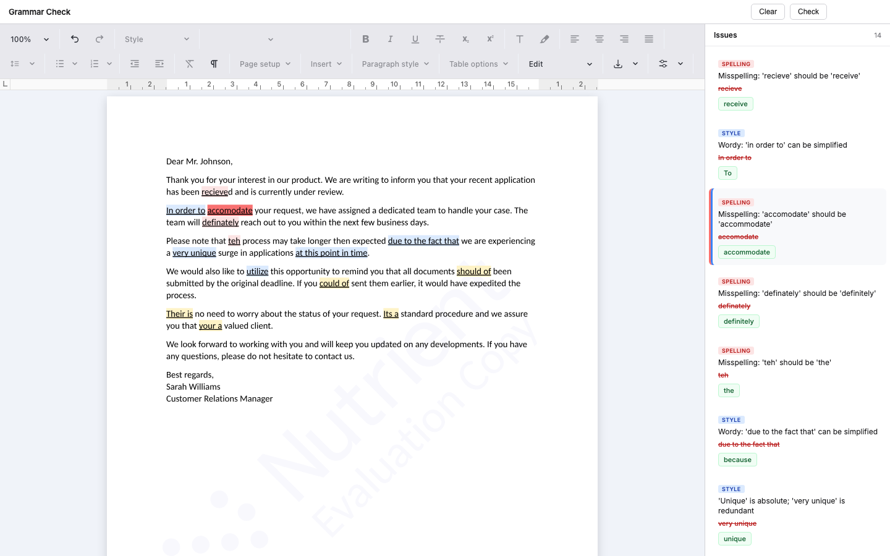
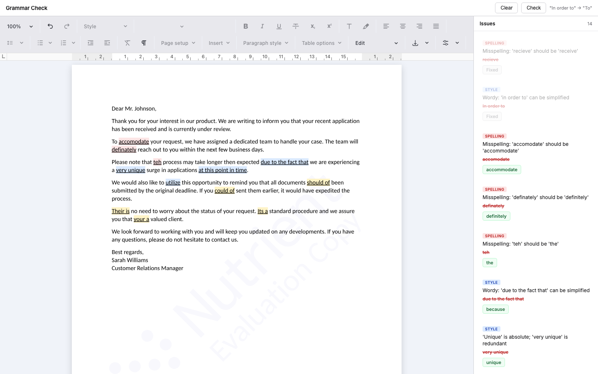

# Nutrient Grammar Check

A Nutrient.io demo that checks the grammar and spelling of a document open in the Nutrient Document Authoring editor, highlights each issue in the text, lists the suggestions in a side panel, and applies a fix with one click.



1. **Editor.** The browser opens a sample letter in the Document Authoring editor (`createDocumentFromPlaintext`).
2. **Text.** **Check** reads the plain text of every paragraph through a document transaction.
3. **Grammar service.** The text goes to `POST /api/grammar-check` on the .NET backend, which returns a list of issues with offset, length, message, suggestion and category (spelling, grammar, style). This demo uses a small built-in rule list; a real grammar or spelling API plugs in at that endpoint.
4. **Highlights.** Each issue is found in its paragraph and formatted with a highlight color per category and an underline.
5. **Positions.** The document is exported to PDF and sent to `POST /api/extract-text`, where GdPicture.NET returns every word with its coordinates. They map the mouse position in the editor to an issue, so hovering a highlight also highlights its card.
6. **Fix.** Clicking a suggestion replaces the text in the document and marks the card as fixed.

## Prerequisites

- .NET SDK 10
- Node.js 18 or later
- Windows, macOS or Linux (GdPicture.API brings the native runtimes for the three)
- A browser with internet access: Document Authoring loads its engine from the Nutrient CDN

## Environment variables

Start from `.env.example`.

| Variable | Purpose | Default |
|---|---|---|
| `GDPICTURE_LICENSE_KEY` | GdPicture.NET license key, used for the text extraction | empty = evaluation mode |
| `ASPNETCORE_URLS` | Backend address when it runs without the launch profile | `http://localhost:5100` from `launchSettings.json` |
| `BACKEND_URL` | Backend address used by the Vite proxy for `/api` | `http://localhost:5100` |

Document Authoring has no license key in this demo: it runs in evaluation mode, with a watermark and a one-hour limit per session.

## Build and run

```bash
cd frontend && npm install
```

```bash
dotnet build backend
```

```bash
./start.sh
```

Open <http://localhost:3000>. `start.sh` starts the backend on port 5100 and the Vite dev server on port 3000.

## Using the app

1. Wait for the sample letter to load in the editor. You can edit it or paste your own text.
2. Click **Check**. Issues are highlighted in the text (red for spelling, yellow for grammar, blue for style) and listed in the **Issues** panel.
3. Hover a card to highlight its issue in the document, or hover a highlight to find its card.
4. Click the green suggestion to apply it. **Clear** removes all highlights.

   

Screenshots were taken in evaluation mode.

## API

| Method and path | Description |
|---|---|
| `POST /api/grammar-check` | Body `{ text }`. Returns `{ issues: [{ offset, length, message, suggestion, category, text }] }` |
| `POST /api/extract-text` | Body: a PDF (`application/pdf`). Returns `{ pageCount, pages: [{ pageNumber, width, height, text, words: [{ x1..y4, text, fontName, fontBoxHeight, textMode, textSize }] }] }` |
| `POST /api/search-text` | Body `{ pdf (base64), text }`. Returns `{ matches: [{ pageNumber, pageWidth, pageHeight, left, top, width, height }] }` |

## Plugging in a grammar API

`SimulateGrammarCheck` in `backend/Program.cs` stands in for a real service. To use one, call its API from the `/api/grammar-check` endpoint, keep its key in an environment variable, and map each finding to the issue shape above. The front end only depends on that shape.

## Known limits

- The built-in rules are a short list of common mistakes, matched as plain text. They are for the demo only.
- Highlights and fixes apply to the first occurrence of the issue text in its paragraph.
- Hover areas come from the PDF export and are matched by text, so not every issue gets one.

## Project layout

| Path | Content |
|---|---|
| `backend/Program.cs` | Minimal API: grammar check, PDF text extraction with coordinates, text search (GdPicture.NET) |
| `frontend/src/main.js` | Document Authoring editor, highlights, side panel, hover mapping, fixes |
| `frontend/src/styles.css` | Styles |
| `start.sh` | Starts the backend and the front end |
